# Registro de mantenimiento — S.V.D.D. School

Curso: Evolución y Mantenimiento de Software (2026-II)
Proyecto base: [rushgala27/School-Management-System](https://github.com/rushgala27/School-Management-System) (Python + Tkinter + SQLite, licencia MIT) — etiqueta `v1.0`.

Clasificación del mantenimiento **basada en la intención** (ISO/IEC 14764):

| Tipo | Intención |
|---|---|
| Correctivo | Reparar un defecto que ya produce fallas observables. |
| Preventivo | Eliminar un defecto latente antes de que se convierta en falla. |
| Adaptativo | Mantener el software utilizable ante cambios de su entorno. |
| Perfectivo | Añadir capacidades o mejorar usabilidad/rendimiento sin que exista falla. |

---

## Versión 2.0 — etiqueta `v2.0`

### R01 — Validación de campos numéricos

- **Descripción:** Mobile No. y Aadhaar Card No. aceptaban letras y caracteres inválidos. Deben restringirse a solo dígitos (10 y 12) y mostrar un mensaje claro cuando el dato no es válido.
- **Prioridad:** Alta
- **Tipo de mantenimiento:** Preventivo — el dato inválido se guardaba sin error, pero dejaba registros corruptos que fallarían al usarse.
- **Commit:** `118b102`
- **Observaciones (problemas durante la modificación):**
  - El `validatecommand` de Tk evalúa el texto completo propuesto: al **pegar** un número con guiones (`8829-3250-8844`, el formato que ya había en la base) se rechazaba entero y el campo quedaba vacío. Hubo que interceptar `<<Paste>>` y limpiar los separadores antes de insertar.
  - La base ya tenía datos que no pasaban la validación: todos los Aadhaar con guiones y registros de prueba con letras (usuarios `2222`, `6666`, `3` y `5555`, este último duplicado). Se escribió una migración idempotente: quita guiones y deja en `NULL` los valores imposibles de recuperar.
  - El director tenía **dos celulares en un solo campo** (`2345671234/4657382910`); la migración conserva el primero.
  - Al probar la edición apareció un defecto previo: *Edit Teacher/Student Info* mapeaba "Aadhaar Card No." a la columna `ano`, que no existe (`OperationalError: no such column: ano`). Se corrigió a `adno`.
- **Evidencia:** 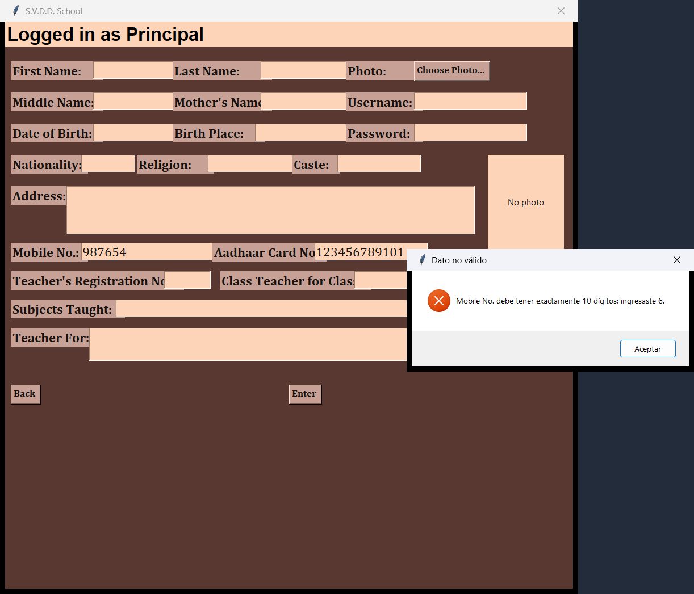

### R02 — Navegación estable entre paneles

- **Descripción:** Al pasar entre *Add New Teacher*, *Edit Personal Info* y *Edit Teacher Info* se abrían ventanas duplicadas y la anterior no siempre se cerraba bien. El botón *Back* debe volver al panel correcto sin perder la sesión.
- **Prioridad:** Alta
- **Tipo de mantenimiento:** Correctivo — falla reproducible: cada clic abría otra ventana y se podía abrir un segundo panel de sesión desde el login.
- **Commit:** `56b2485`
- **Observaciones:**
  - Cada `Toplevel` volvía a llamar a `mainloop()`: había **8 bucles de eventos anidados** y cada ventana abierta apilaba uno más. Se dejó un solo `mainloop()` en la ventana raíz.
  - El login seguía visible durante la sesión, así que se podían abrir paneles dobles. Al ocultarlo, cerrar el panel con la **X** dejaba el proceso vivo sin ninguna ventana visible; hubo que asignar `WM_DELETE_WINDOW` para que la X haga lo mismo que *Back* (cerrar sesión y volver al login).
  - Con un usuario inexistente el login mostraba el error y luego se caía con `TypeError: 'NoneType' object is not subscriptable`.
  - En las pruebas, `winfo_exists()` lanzaba `TclError` al consultar una ventana de un intérprete Tk ya destruido (en lugar de devolver `False`); se protegió el registro de ventanas.
- **Evidencia:** usuario inexistente sin excepción y vuelta al login limpio tras *Back*:
  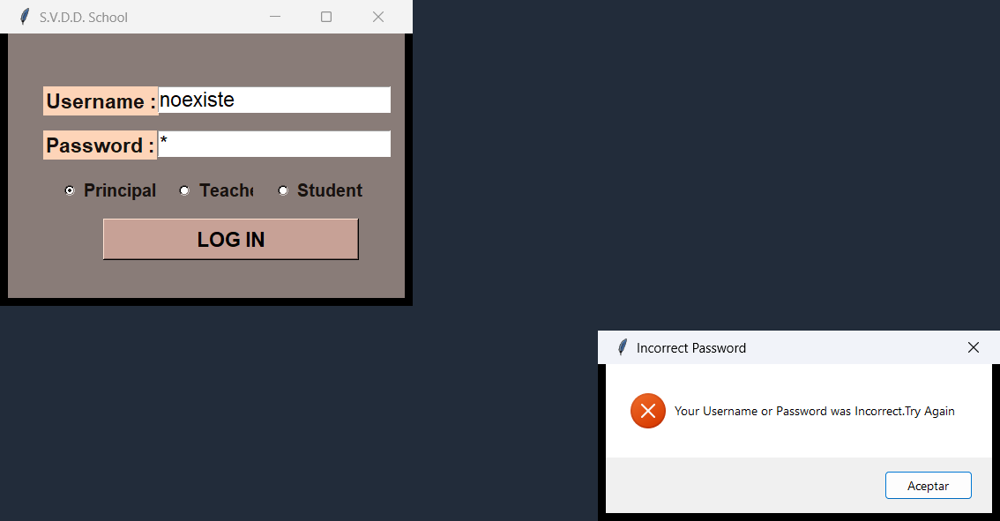
  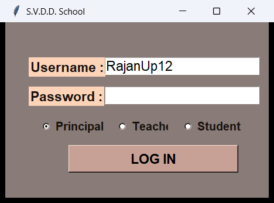

### R03 — Carga y vista previa de foto

- **Descripción:** El campo Photo solo guardaba un texto de referencia (`PHOTO11`), no la imagen. Se implementa selector de archivo con miniatura y validación del formato antes de guardar.
- **Prioridad:** Media
- **Tipo de mantenimiento:** Perfectivo — capacidad nueva; no corrige una falla existente.
- **Commit:** `bb1a307`
- **Observaciones:**
  - Las tablas no tenían dónde guardar la imagen. `ALTER TABLE ... ADD COLUMN photo_blob BLOB` conserva los registros, pero **rompió todos los `INSERT ... VALUES` posicionales** (`table TeacherData has 20 columns but 19 values were supplied`). Se reescribieron con columnas explícitas y parámetros `?`; de paso, los apellidos con apóstrofo (`D'Souza`) ya no rompen el SQL.
  - Tk no lee JPG de forma nativa: se agregó Pillow (`requirements.txt`).
  - La extensión no basta: un `.txt` renombrado a `.png` pasaba el filtro del selector. Se valida el contenido con `Image.verify()`, el formato y un máximo de 2 MB.
  - La miniatura aparecía en blanco si el `PhotoImage` solo vivía en una variable local (Python lo libera); se guarda la referencia en el propio `Label`.
- **Evidencia:** archivo falso rechazado, miniatura en el alta y foto en el panel del docente:
  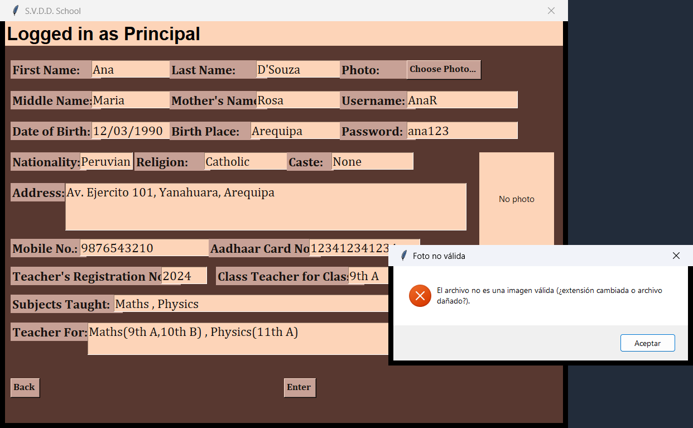
  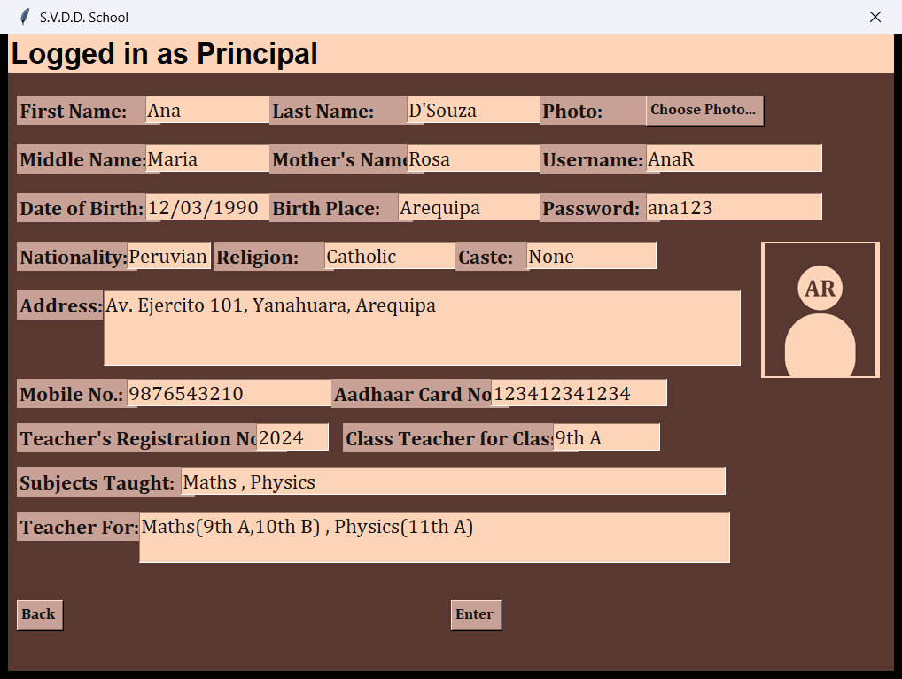
  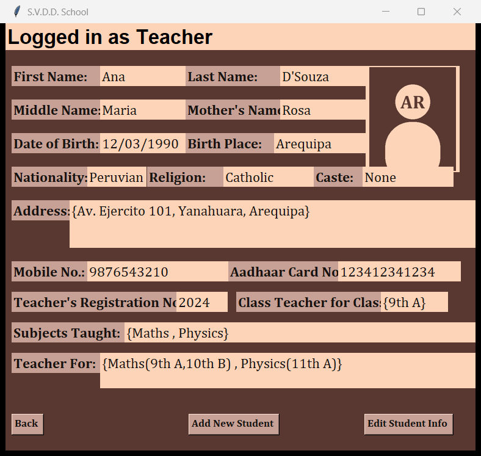

---

## Versión 3.0 — etiqueta `v3.0`

Sin cambios de código: se agrega el campo **Tipo de mantenimiento** a cada requerimiento de la v2.0 (clasificación basada en la intención, arriba) y este registro al repositorio.

| Req. | Título | Tipo de mantenimiento |
|---|---|---|
| R01 | Validación de campos numéricos | Preventivo |
| R02 | Navegación estable entre paneles | Correctivo |
| R03 | Carga y vista previa de foto | Perfectivo |

---

## Versión 4.0 — etiqueta `v4.0`

Requerimientos nuevos. Cada uno lleva el **tipo de mantenimiento** (clasificación basada en la intención) y el **tipo de modificación**. Se implementó primero R03 porque R01 y R02 se apoyan en la conexión única.

### R01 — Navegación de ventana única

- **Descripción:** Cada botón (*Add New Teacher*, *Edit Personal Info*, *Edit Teacher Info*…) abría un `Toplevel` nuevo, que quedaba abierto detrás del panel. Se migra a una sola ventana raíz cuyas pantallas son `Frame` que se reemplazan entre sí.
- **Prioridad:** Alta
- **Tipo de mantenimiento:** Basada en la intención
- **Tipo de modificación:** Correctiva
- **Commit:** `0ee9792`
- **Observaciones:**
  - Un `Frame` no tiene `title()`, `geometry()` ni `protocol()`: todas esas llamadas, repetidas en cada ventana, tuvieron que salir, y el tamaño pasó a controlarse desde la ventana raíz.
  - Los formularios de edición **solo creaban el botón *Back* después de elegir un campo y pulsar *Enter***. Con `Toplevel` se podían cerrar con la X, pero dentro de la ventana única el usuario quedaba atrapado. *Back* existe ahora desde el inicio.
  - Tras editar un dato, el panel original seguía mostrando el valor viejo hasta volver a iniciar sesión. Ahora la sesión (rol, usuario y contraseña) vive en el navegador, y *Back* reconstruye el panel con los datos actualizados.
- **Evidencia:** panel y formulario de alta dentro de la misma ventana (sección R02).

### R02 — Diseño responsivo del panel de datos

- **Descripción:** El panel y los formularios ubicaban cada `Label`/`Entry` con `place(x, y)` en píxeles fijos. Con otra resolución, fuente o escala de Windows, los campos quedaban recortados o con márgenes vacíos. Se reemplaza por `grid()` con pesos (`columnconfigure`/`rowconfigure weight`), para que los campos se acomoden al tamaño de la ventana.
- **Prioridad:** Alta
- **Tipo de mantenimiento:** Basada en la intención
- **Tipo de modificación:** Perfectiva
- **Commit:** `32a8618`
- **Observaciones:**
  - Con la escala de Windows activa, las etiquetas se cortaban porque las fuentes crecían y las coordenadas no ("Mother's Nam", "Teacher's Registration No" y "Teache" en el login; ver la captura R01 de la v2). Además, el formulario de alta original medía 1000×1000 y no cabía en una pantalla de 864 px lógicos.
  - Las tres copias casi idénticas de cada pantalla (alumno, docente y director) obligaban a migrar cada widget tres veces. Se unificaron en una sola pantalla guiada por tablas de campos (~900 → ~410 líneas).
  - Con los valores a ancho mínimo 1, los datos cortos se partían en el tamaño mínimo ("Upadhy/ay", "24/07/1968" en dos líneas). Se les dio un ancho mínimo según el dato.
  - El primer `<Configure>` llega con ancho ≈ 1 antes de que `grid` reparta el espacio. Eso fijaba un `wraplength` de 40 px y la ventana se medía 190 px más alta de lo necesario. Ahora se ignoran esos anchos.
  - La pantalla de edición se medía antes de mostrar los campos, y el botón *UPDATE* quedaba cortado. Hay que volver a medir al mostrarlos. Además, cada *Enter* apilaba widgets nuevos sobre los anteriores; ahora se crean una sola vez.
- **Evidencia:** tamaño natural y ventana agrandada (la dirección pasa de 628 a 1218 px de ancho):
  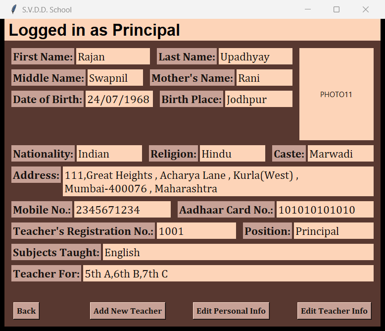
  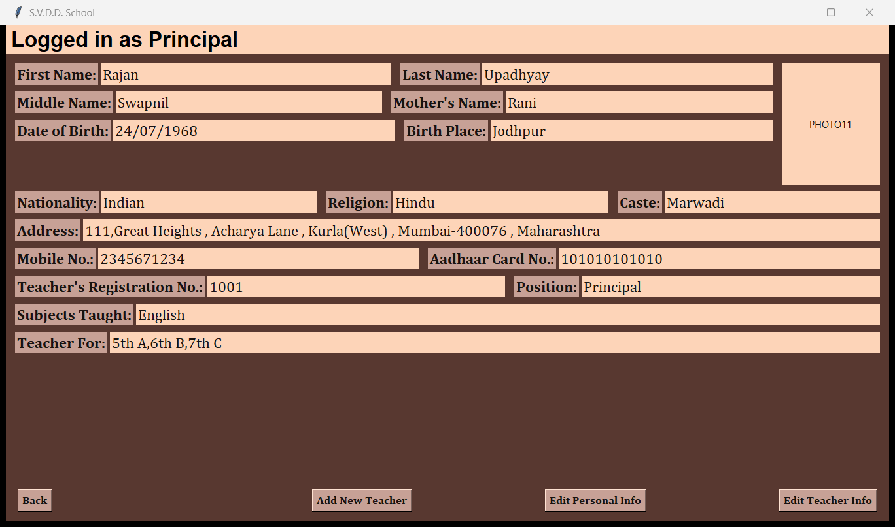
  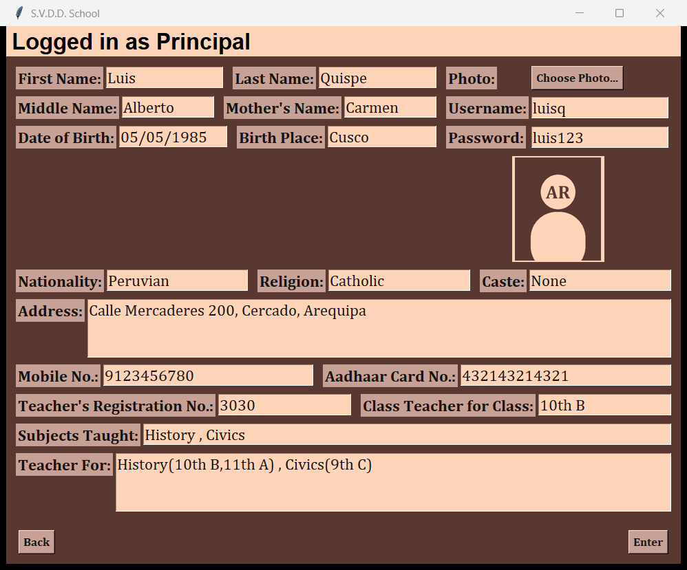
  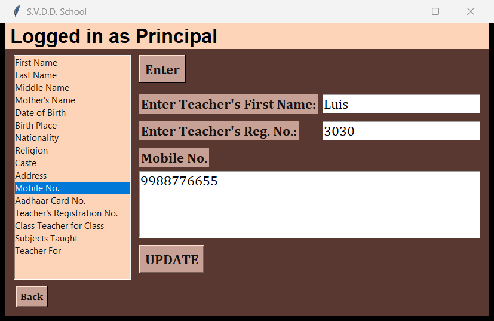
  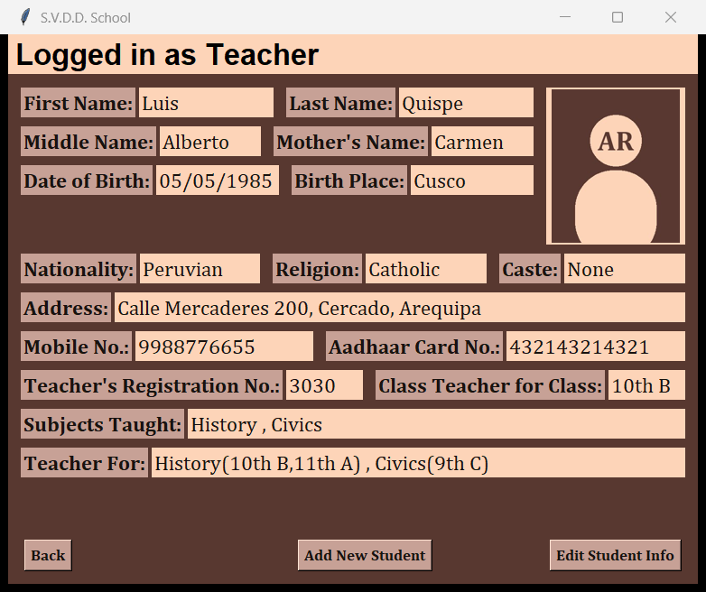
  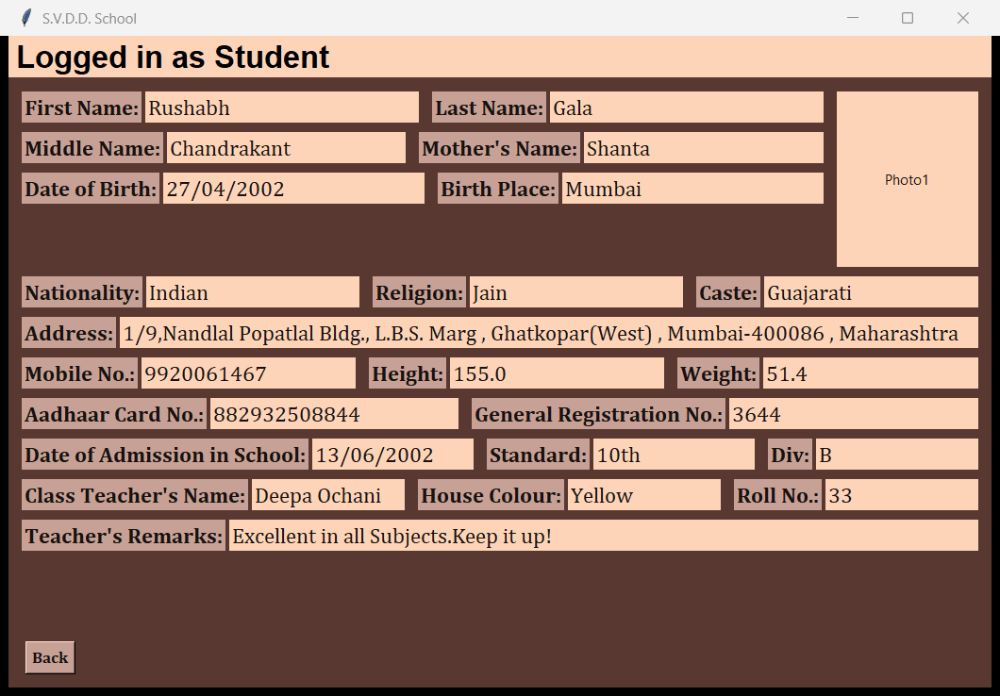

### R03 — Centralización de la conexión a SQLite

- **Descripción:** La conexión se abría con una ruta relativa, cada consulta concatenaba texto en el SQL y un bloqueo de la base terminaba en una excepción. Se centraliza en una clase única (Singleton) que gestiona una sola conexión compartida.
- **Prioridad:** Media
- **Tipo de mantenimiento:** Basada en la intención
- **Tipo de modificación:** Preventiva
- **Commit:** `b6fc424`
- **Observaciones:**
  - `sqlite3.connect("testdata.db")` es relativo a la carpeta desde donde se ejecuta. Al abrir el programa desde otra carpeta, **creaba un `testdata.db` vacío** y fallaba con `no such table: PrincipalData`. La ruta ahora es absoluta, y si el archivo no existe se avisa en lugar de crear uno vacío.
  - En modo de diario `DELETE` (el predeterminado), una lectura falla con `database is locked` mientras otro programa (por ejemplo, un visor de SQLite) tiene una escritura abierta. Con `PRAGMA journal_mode=WAL` las lecturas siguen funcionando; las escrituras aún esperan, así que se agregó `busy_timeout` y un mensaje claro en vez de la excepción. Ambos casos tienen prueba automática.
  - WAL crea los archivos `testdata.db-wal` y `-shm`, que se excluyeron de Git. Además, los cambios quedan en el `-wal` hasta el cierre: se verificó que cerrar la conexión los vuelca al archivo principal.
  - Los nombres de columna no se pueden pasar como parámetro `?`, así que se validan contra el esquema real (`PRAGMA table_info`).
  - Al parametrizar los `UPDATE` salieron tres defectos previos. Se decía "Updated Successfully" aunque ningún registro coincidiera. "General Registration No." no tenía columna asociada y lanzaba `NameError`. Y los paneles mostraban los valores entre llaves `{…}` porque le pasaban una tupla a `StringVar`.
- **Evidencia:** un visor externo mantiene una escritura abierta y la app avisa en vez de caerse:
  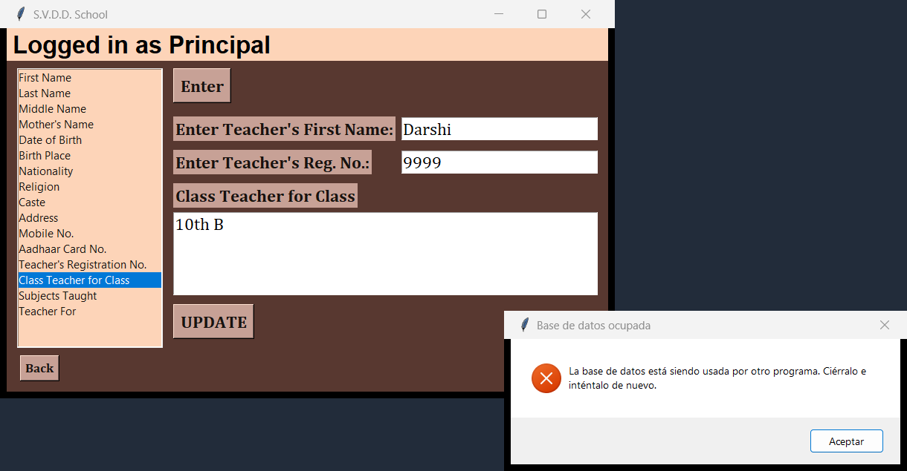

### Resumen v4.0

| Req. | Título | Tipo de mantenimiento | Tipo de modificación |
|---|---|---|---|
| R01 | Navegación de ventana única | Basada en la intención | Correctiva |
| R02 | Diseño responsivo del panel de datos | Basada en la intención | Perfectiva |
| R03 | Centralización de la conexión a SQLite | Basada en la intención | Preventiva |

---

## Versión 4.1 — etiqueta `v4.1`

### Interfaz en español

- **Descripción:** Toda la interfaz del sistema original estaba en inglés (login, paneles, botones, formularios y mensajes). Se traduce al español: roles *Director / Docente / Alumno*; botones *Ingresar, Cerrar sesión, Nuevo docente, Editar mis datos, Guardar, Volver, Actualizar*; etiquetas de todos los campos y todos los mensajes de error y confirmación.
- **Prioridad:** Media
- **Tipo de mantenimiento:** Perfectivo — mejora la usabilidad para usuarios hispanohablantes; no corrige una falla.
- **Observaciones:**
  - Los textos en español son más largos ("Fecha de nacimiento:" frente a "Date of Birth:"). Con el diseño original en `place(x, y)` se habrían encimado; con el `grid` de la v4.0 la ventana creció sola (panel del director de 760 a 942 px de ancho) y la prueba automática confirma que ninguna etiqueta se corta ni se solapa.
  - Los mensajes de validación de la v2.0 mezclaban idiomas ("Mobile No. solo admite números"); ahora son frases completas en español ("El celular solo admite números").
  - Los datos de ejemplo de la base (nacionalidad, religión, direcciones en Mumbai) vienen del proyecto original y se dejaron tal cual: son datos, no parte de la interfaz.
- **Evidencia:**
  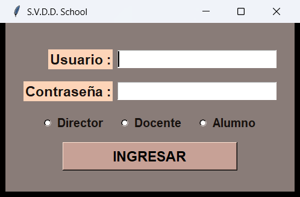
  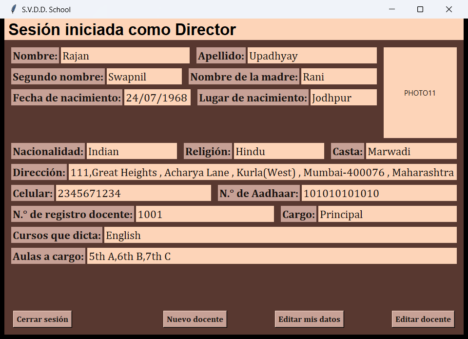
  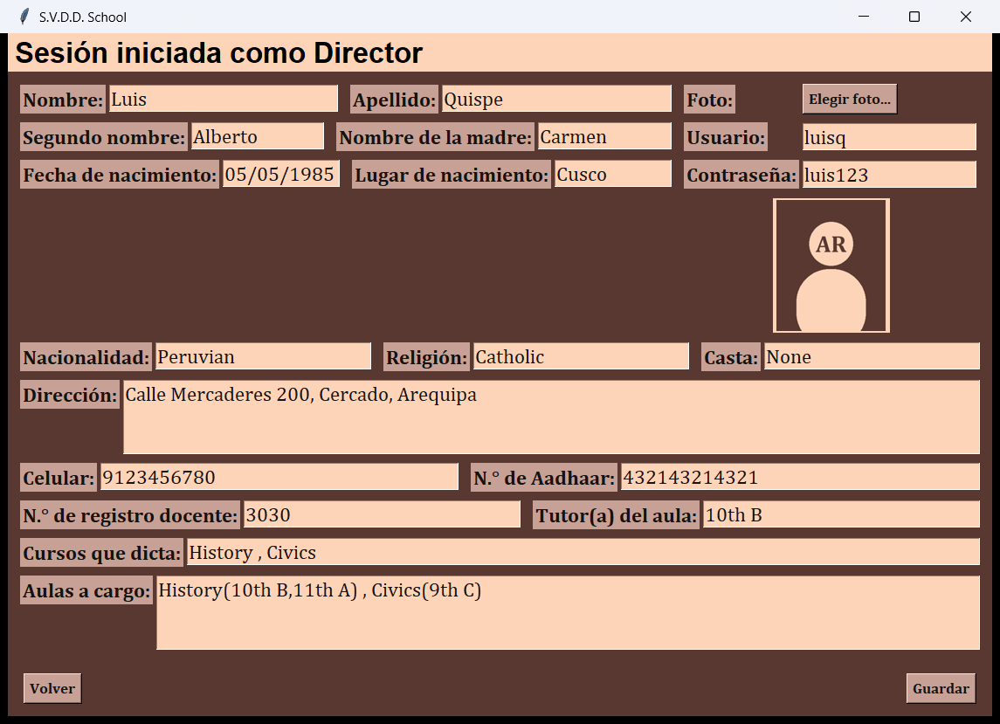
  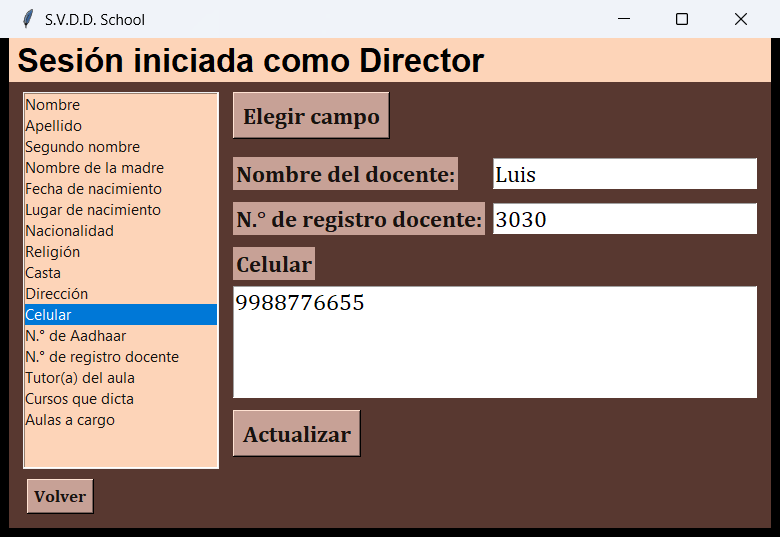

---

## Versión 5.0 — etiqueta `v5.0`

Requerimientos funcionales del sistema de gestión escolar. En la hoja original el último requerimiento aparecía repetido como **R05**; aquí se numera **R07** para que cada código sea único. Se implementaron en este orden: R07 → R06 → R01 → R02 → R03 → R04 → R05, porque la gestión de registros se apoya en las transacciones (R07) y en la validación (R06).

### R01 — Gestión de estudiantes

- **Descripción:** El sistema deberá permitir registrar, consultar, actualizar y eliminar los datos de los estudiantes, almacenándolos en la base de datos SQLite.
- **Prioridad:** Alta
- **Tipo de mantenimiento:** Basada en la intención
- **Tipo de modificación:** Perfectiva
- **Commit:** `5c3298e`
- **Observaciones:** Validar los campos obligatorios y evitar registros duplicados.
  - Antes solo existían el alta y la edición de **un campo**, escribiendo a mano el nombre y el N.° de registro; no había forma de ver la lista ni de eliminar. Ahora hay una pantalla *Gestión de alumnos* (listado, Nuevo, Editar, Eliminar con confirmación) y el mismo formulario del alta sirve para editar con todos los datos cargados.
  - El `Treeview` guarda los identificadores como texto (`"3644"`) y la base como entero (`3644`). Se mantiene un mapa iid → clave real para no depender de conversiones implícitas de SQLite.
  - Al editar, si no se elige otra foto, se conserva la actual (antes la foto solo se podía elegir en el alta).
- **Evidencia:**
  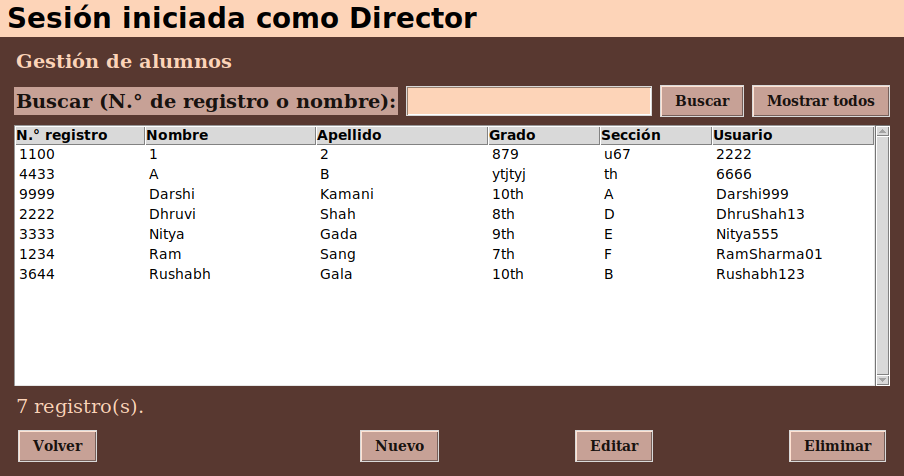
  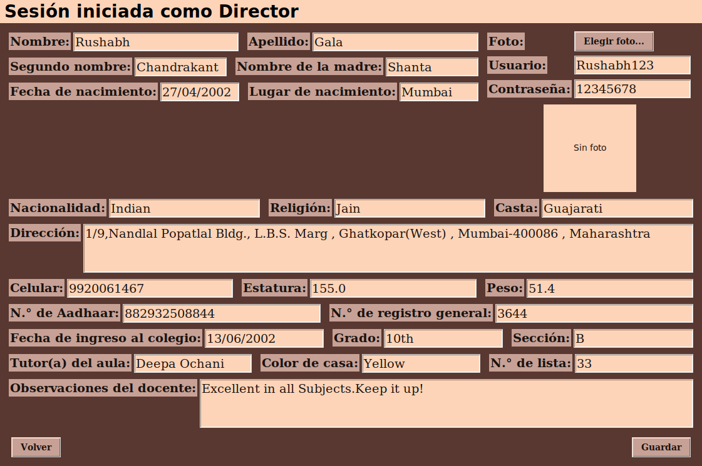

### R02 — Gestión de docentes

- **Descripción:** El sistema deberá permitir registrar, consultar, actualizar y eliminar la información de los docentes de la institución educativa.
- **Prioridad:** Alta
- **Tipo de mantenimiento:** Basada en la intención
- **Tipo de modificación:** Perfectiva
- **Commit:** `9e7e309`
- **Observaciones:** Validar los datos obligatorios y conservar los cambios en SQLite.
  - El director accede desde su panel (*Docentes*); el docente no ve esa opción.
  - Un docente con cursos a cargo no se puede eliminar: el sistema indica cuántos cursos tiene y que hay que reasignarlos primero.
  - Si cambia el N.° de registro de un docente, sus cursos lo siguen (`ON UPDATE CASCADE`).
- **Evidencia:** 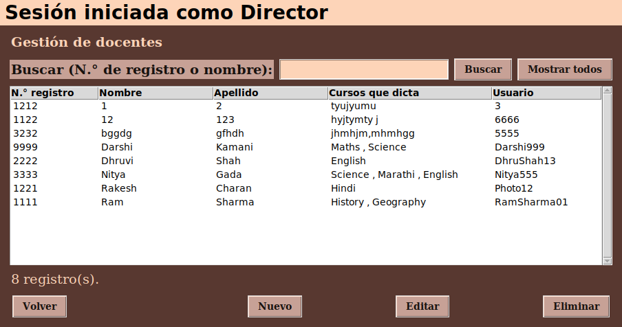

### R03 — Gestión de cursos

- **Descripción:** El sistema deberá permitir registrar, consultar, actualizar y eliminar los cursos de la institución educativa.
- **Prioridad:** Alta
- **Tipo de mantenimiento:** Basada en la intención
- **Tipo de modificación:** Perfectiva
- **Commit:** `ed9c88b`
- **Observaciones:** Cada curso deberá contar con un identificador único. Las relaciones con otros registros deberán verificarse antes de eliminarlo.
  - La base no tenía tablas de cursos. Se creó `Curso` con `id INTEGER PRIMARY KEY` y `codigo UNIQUE` (se guarda en mayúsculas: `mat-10` y `MAT-10` son el mismo curso).
  - Para que `Curso.trno` sea clave foránea de `TeacherData(trno)`, esa columna necesita un índice único; sin él SQLite responde `foreign key mismatch` en cada escritura. Por eso R07 (índices únicos) tuvo que ir antes.
  - Un curso con alumnos matriculados no se puede eliminar.
- **Evidencia:**
  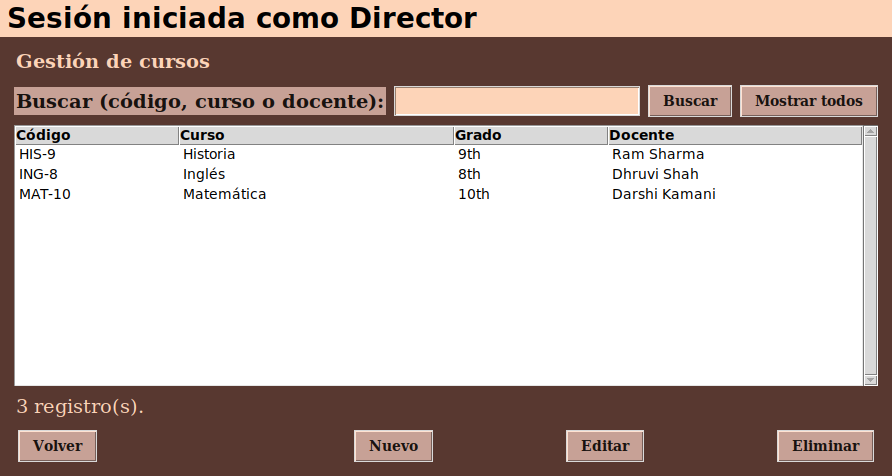
  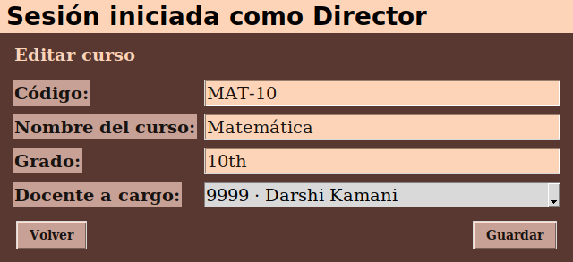

### R04 — Registro de matrículas

- **Descripción:** El sistema deberá permitir registrar y consultar las matrículas, asociando a cada estudiante con el grado o curso y el periodo académico correspondiente.
- **Prioridad:** Alta
- **Tipo de mantenimiento:** Basada en la intención
- **Tipo de modificación:** Perfectiva
- **Commit:** `a715f52`
- **Observaciones:** Verificar que el estudiante esté registrado y evitar matrículas duplicadas para la misma asignación y periodo.
  - Tabla `Matricula` con `UNIQUE(gno, curso_id, periodo)` y claves foráneas a `StudentData(gno)` y `Curso(id)`. La aplicación revisa antes de guardar (mensaje claro) y la base lo vuelve a impedir si algo se escapa.
  - Alumno y curso se eligen de listas, para no escribir números a mano. El periodo (`2026-II`) se propone según la fecha: enero-julio es el I y agosto-diciembre el II.
  - Una matrícula equivocada se **anula** y se registra otra; no se edita, para no perder qué se registró y cuándo.
- **Evidencia:**
  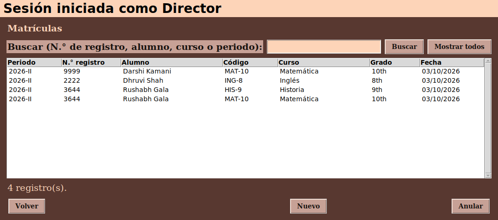
  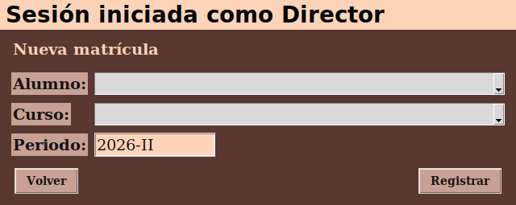

### R05 — Búsqueda y consulta de información

- **Descripción:** El sistema deberá permitir localizar y consultar los registros mediante criterios de búsqueda, como identificador o nombre.
- **Prioridad:** Media
- **Tipo de mantenimiento:** Basada en la intención
- **Tipo de modificación:** Perfectiva
- **Commit:** `f610ff0`
- **Observaciones:** Mostrar los resultados en la interfaz e informar cuando no existan coincidencias.
  - El identificador debe coincidir completo (buscar `364` no trae al `3644`); el nombre basta con que contenga lo escrito, sin distinguir mayúsculas.
  - `%` y `_` son comodines de `LIKE`: sin escaparlos, buscar `%` traería a todos. Se escapan para que se busquen como texto.
  - Limitación conocida: `LIKE` de SQLite solo ignora mayúsculas en letras ASCII, así que `lucia` no encuentra `Lucía`.
- **Evidencia:** 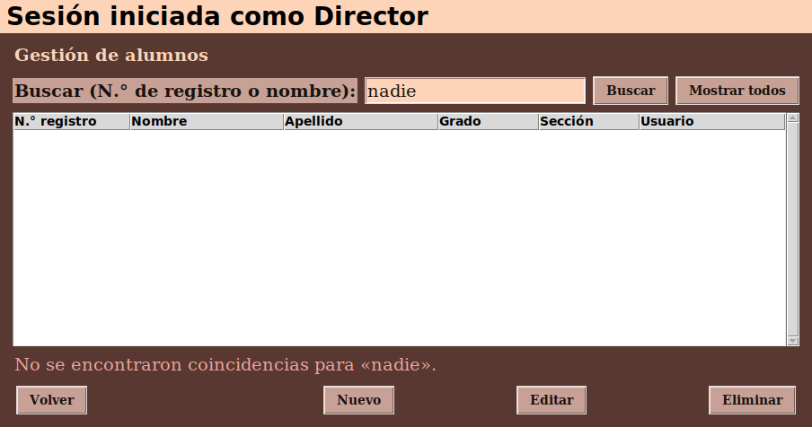

### R06 — Validación de datos

- **Descripción:** El sistema deberá validar los datos antes de guardarlos, rechazando campos obligatorios vacíos, formatos incorrectos y duplicados según las reglas de cada registro.
- **Prioridad:** Alta
- **Tipo de mantenimiento:** Basada en la intención
- **Tipo de modificación:** Correctiva
- **Commit:** `37611c1`
- **Observaciones:** Mostrar mensajes claros que indiquen el error y permitir corregirlo sin perder los demás datos ingresados.
  - El alta permitía guardar un alumno o docente sin nombre, usuario ni contraseña. Ahora cada tipo de registro tiene sus reglas (obligatorios, enteros, decimales, fechas `dd/mm/aaaa`, celular y Aadhaar, código de curso, periodo).
  - Se muestran **todos** los errores juntos, los campos con problema se pintan y el cursor va al primero. Lo escrito no se borra.
  - `31/02/2012` tiene el formato correcto pero no existe: se valida con `datetime.strptime`, no solo con una expresión regular.
  - La base trae fechas inválidas de prueba (`tyjuyj`, `jtyutr`). No se tocaron con una migración (no se puede adivinar la fecha real): el sistema las marca cuando alguien edita ese registro.
- **Evidencia:** 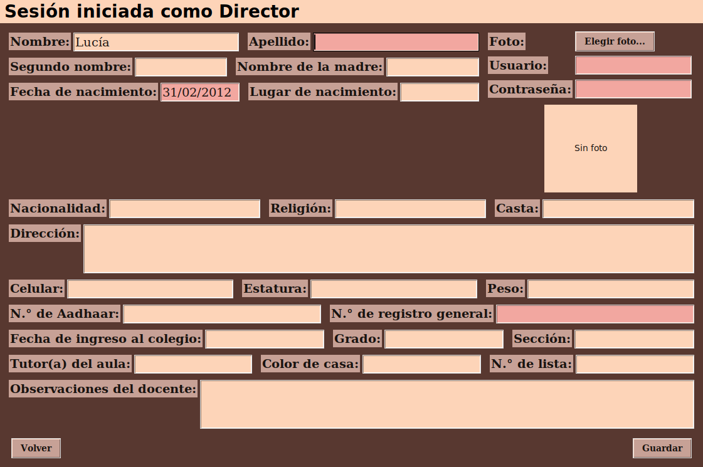

### R07 — Persistencia e integridad de la información

- **Descripción:** El sistema deberá almacenar la información en SQLite y recuperarla al reiniciar la aplicación, manteniendo la consistencia de los registros y sus relaciones.
- **Prioridad:** Alta
- **Tipo de mantenimiento:** Basada en la intención
- **Tipo de modificación:** Preventiva
- **Commit:** `ce16937`
- **Observaciones:** Confirmar las operaciones realizadas y revertir los cambios cuando ocurra un error durante el guardado.
  - SQLite **no revisa las claves foráneas** salvo que cada conexión active `PRAGMA foreign_keys = ON`.
  - Con `with con:` anidados, el interno confirma a mitad de una operación compuesta. `BaseDatos.transaccion()` solo confirma en la transacción externa y revierte todo ante cualquier excepción.
  - No se pudo crear el índice único de `TeacherData.username` porque el usuario `5555` estaba **dos veces, idéntico**. La migración borra solo copias exactas; si hubiera duplicados distintos, avisa en vez de borrar datos.
  - Un `IntegrityError` llega como `ErrorIntegridad` con un mensaje en español ("Ya existe un registro con ese usuario"), y cada operación correcta se confirma con un mensaje.
  - Las pruebas cierran y reabren la base para comprobar que los datos se recuperan.

### Resumen v5.0

| Req. | Título | Prioridad | Tipo de modificación |
|---|---|---|---|
| R01 | Gestión de estudiantes | Alta | Perfectiva |
| R02 | Gestión de docentes | Alta | Perfectiva |
| R03 | Gestión de cursos | Alta | Perfectiva |
| R04 | Registro de matrículas | Alta | Perfectiva |
| R05 | Búsqueda y consulta de información | Media | Perfectiva |
| R06 | Validación de datos | Alta | Correctiva |
| R07 | Persistencia e integridad de la información | Alta | Preventiva |

---

## Versión 6.0 — etiqueta `v6.0`

Iteración de 5 cambios documentada con la plantilla **Plan y Reporte de Mantenimiento (IEEE Std 14764-2006)**. Cada cambio es una solicitud de modificación (MR) con su tipo de mantenimiento según la intención. Diagramas UML de secuencia en `docs/diagramas/v6/`; capturas antes/después en `docs/capturas/v6/`. La EV03 (hoja *2026-II - Mantenimiento v6.0*, pestaña JERSON) suma dos requerimientos: R01 = MR-106 y R02 = MR-107.

| MR | Nombre | Tipo | Componente | Prioridad |
|---|---|---|---|---|
| MR-101 | Búsqueda sin tildes ni mayúsculas | Correctivo | `gestion.py`, `db.py`, `texto.py` | P1 Alta |
| MR-102 | Edición de datos del director con formulario completo | Correctivo | `pantallas.py`, `gestion.py` | P1 Alta |
| MR-103 | Base de datos en la carpeta del usuario si la del .exe es de solo lectura | Adaptativo | `db.py` | P2 Media |
| MR-104 | Respaldo de la base desde la aplicación | Perfectivo | `db.py`, `pantallas.py` | P3 Normal |
| MR-105 | Contraseñas con hash PBKDF2 + sal | Preventivo | `seguridad.py`, `db.py`, `migraciones.py`, `gestion.py` | P2 Media |
| MR-106 (EV03 R01) | Registro de notas por matrícula | Perfectivo | `migraciones.py`, `gestion.py`, `pantallas.py` | P1 Alta |
| MR-107 (EV03 R02) | Restaurar un respaldo desde la aplicación | Perfectivo | `db.py`, `pantallas.py` | P2 Media |

### MR-101 — Búsqueda sin tildes ni mayúsculas

- **Descripción:** buscar `lucia` no encontraba a *Lucía*, ni `JOSÉ` a *José*: el `LIKE` de SQLite solo ignora mayúsculas en letras ASCII (limitación anotada en la v5.0 R05).
- **Tipo:** Correctivo — falla observable en el listado ("No se encontraron coincidencias").
- **Observaciones:**
  - Se registra en la conexión una función `plano()` (NFD sin marcas diacríticas + `casefold()`) y se compara `plano(columna) LIKE plano(texto)`.
  - En las primeras capturas «lucia» sí aparecía en la v5.0… porque el **usuario** del alumno de prueba era `lucia` y la búsqueda también mira el usuario. Se cambió el dato de prueba a `alu5001` para que la prueba demuestre el defecto de verdad.
  - Costo medido con 10 007 alumnos: 3 ms → ~30 ms por búsqueda (la función se evalúa en Python por fila). Aceptable para un colegio; con muchos más registros convendría guardar una columna normalizada con índice.
- **Evidencia:** 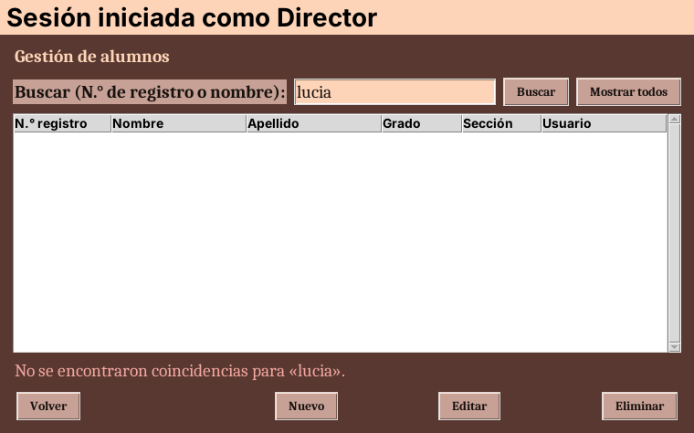 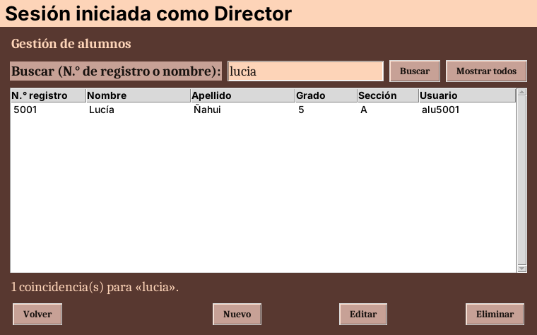

### MR-102 — Edición de datos del director con formulario completo

- **Descripción:** *Editar mis datos* pedía escribir a mano nombre y N.° de registro y cambiaba un solo campo en un cuadro de texto.
- **Tipo:** Correctivo — fallas reproducidas en la v5.0: con `Rajan ` (espacio final) o `rajan` respondía "Ningún registro coincide"; y el valor se guardaba con el salto de línea del cuadro de texto (`'Peruvian\n'`).
- **Observaciones:**
  - Se reutiliza el formulario completo de alumnos/docentes (v5.0), identificado por el N.° de registro de la sesión: no se escribe nada a mano y se aplican las mismas reglas de validación y normalización (R06).
  - Si el director cambia su usuario o contraseña, la sesión se actualiza para que *Volver* no lo saque al login.
  - Se eliminó la pantalla de edición campo a campo (~75 líneas).
- **Evidencia:** 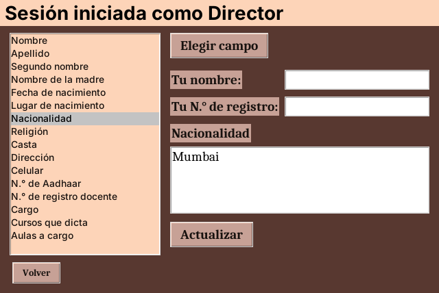 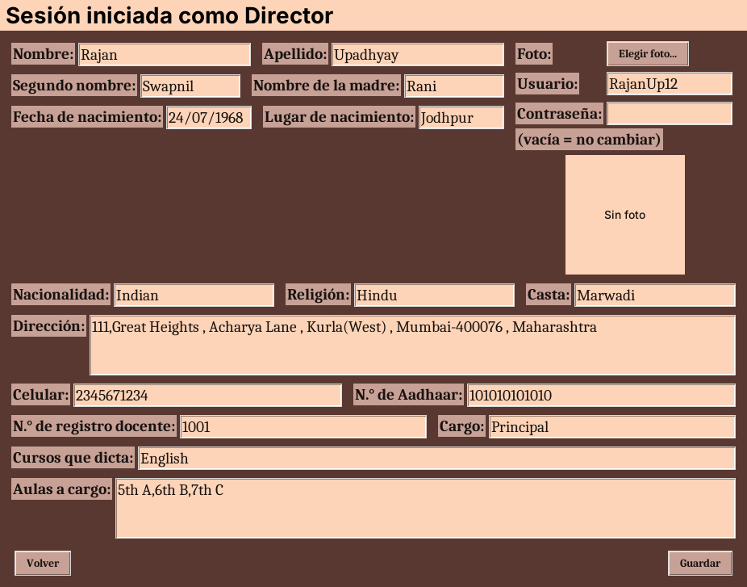

### MR-103 — Base en la carpeta del usuario si la del .exe es de solo lectura

- **Descripción:** el `.exe` guardaba `testdata.db` junto al ejecutable. Instalado en `C:\Program Files` (o una carpeta sin permiso de escritura) la copia inicial fallaba con `PermissionError`, y en modo WAL SQLite necesita crear `-wal` y `-shm` junto a la base.
- **Tipo:** Adaptativo — el programa se adapta a un entorno de instalación distinto, no corrige su lógica.
- **Observaciones:**
  - `os.access()` no sirve en Windows (responde que sí en Program Files): se prueba creando un archivo temporal real.
  - Si ya había una base junto al `.exe` (versión anterior), se copia esa a `%LOCALAPPDATA%\SVDD-School\` para no perder datos; si no, la incluida en el ejecutable.
  - Solo se pudo probar simulando la carpeta de solo lectura (las pruebas corren como administrador en Linux); falta comprobarlo con un instalador real en Windows.

### MR-104 — Respaldo de la base desde la aplicación

- **Descripción:** botón *Respaldo* en el panel del director que guarda `respaldos/testdata-AAAAMMDD-HHMMSS.db` y conserva las 10 copias más recientes.
- **Tipo:** Perfectivo — capacidad nueva.
- **Observaciones:**
  - Copiar el archivo con `shutil` no sirve en modo WAL: los cambios recientes siguen en `testdata.db-wal`. Se usa `Connection.backup()` de SQLite; la prueba verifica que un alta aún no volcada aparece en la copia y que `PRAGMA integrity_check` da `ok`.
  - La prueba de "conservar solo las más recientes" falló dos veces: por orden alfabético `…-1.db` queda antes que `….db`, y al reutilizar un número ya borrado la copia nueva se ordenaba como la más vieja. Se ordena por (fecha, número) y el número siempre crece.
  - Restaurar un respaldo desde la app quedó fuera de esta versión.
- **Evidencia:** 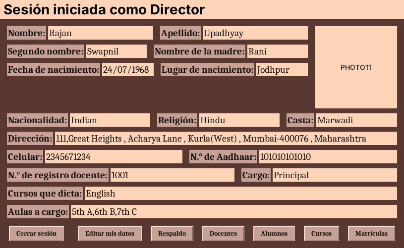

### MR-105 — Contraseñas con hash

- **Descripción:** las contraseñas estaban en texto plano en la base y en cualquier copia de ella.
- **Tipo:** Preventivo — defecto latente de seguridad; aún no había producido una falla.
- **Observaciones:**
  - Formato `pbkdf2_sha256$120000$sal$hash`, comparación con `hmac.compare_digest`. La migración es idempotente y los usuarios siguen entrando con su misma contraseña.
  - El formulario de edición ya no puede mostrar la contraseña: queda vacía y "vacía = no cambiarla". En el alta sigue siendo obligatoria.
  - `autenticar()` ya no compara en el SQL; tres pruebas de `test_db.py` insertaban o comparaban contraseñas planas y se ajustaron.
  - Con 120 000 iteraciones el login tarda ~30 ms y la suite pasó de ~2 s a ~46 s (muchos altas con hash).
- **Evidencia:** `pbkdf2_sha256$120000$7cc183…` en lugar de `RUpadhyay123`.

### MR-106 (EV03 R01) — Registro de notas por matrícula

- **Descripción:** la matrícula (v5.0 R04) solo decía qué alumno lleva qué curso; no había dónde guardar su calificación. Ahora:
  - **BD:** columna `nota` en `Matricula` (entero de 0 a 20, escala vigesimal; vacía = sin nota).
  - **Pantalla:** botón *Nota* (o doble clic) en Matrículas, y *Mis notas* en el panel del alumno, con estado Aprobado (desde 11), Desaprobado o Sin nota, y su promedio.
  - **Permisos:** el docente solo registra notas de los cursos que tiene a cargo; el director, de cualquiera; el alumno solo consulta las suyas.
- **Tipo:** Perfectivo — función nueva pedida por los usuarios; no corrige una falla.
- **Observaciones:**
  - Es una **migración del esquema con la base en uso**: `ALTER TABLE Matricula ADD COLUMN nota INTEGER CHECK (nota IS NULL OR nota BETWEEN 0 AND 20)`. Las matrículas que ya existían se conservan con nota vacía y la migración no hace nada si la columna ya está (idempotente). Sigue el enfoque **iterativo** del material de migración: se cambia un componente a la vez (la tabla y luego las pantallas) sin detener el sistema ni copiar la base a otra.
  - El `CHECK` es la segunda barrera: aunque un formulario no validara, la base rechaza un 21 (`IntegrityError`); hay una prueba que lo comprueba.
  - La entrada de la nota reutiliza `configurar_numerico` (v2.0 R01): solo acepta dos dígitos, así que «-1», «15.5» o letras no se pueden ni escribir; de todos modos `registrar_nota` los rechaza si llegan por otro camino.
  - El recorrido automático (`verificar_app.py`) matriculaba al primer alumno de la lista y creaba el curso *sin docente*: con la regla de permisos, el docente de prueba no podía poner nota en su propio curso. Se ajustó el script para asignarle el curso y matricular a Rushabh, que luego ve su nota.
  - Las matrículas no eran editables: el doble clic no hacía nada. Ahora abre el formulario de la nota.
- **Evidencia:** 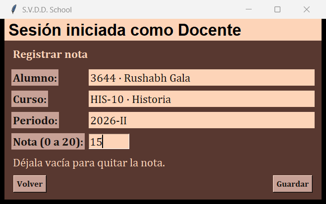 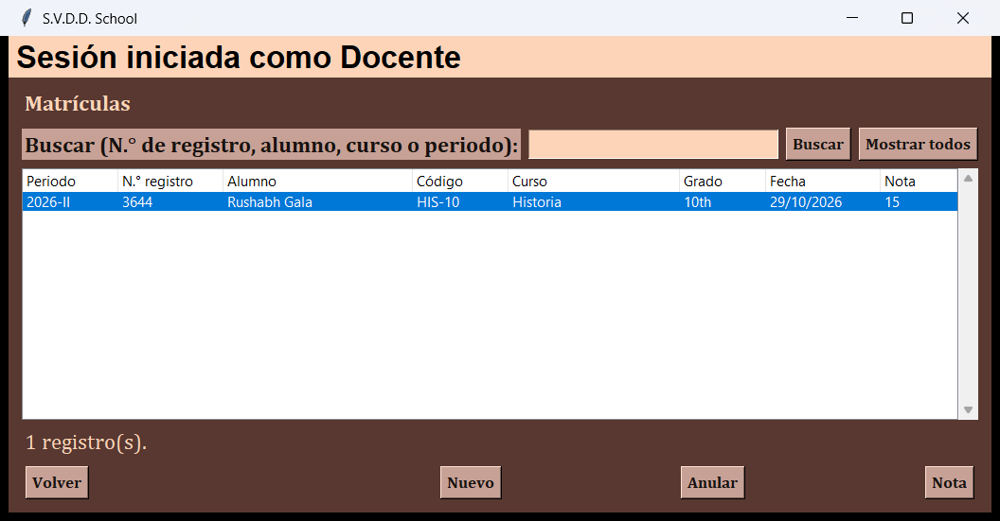 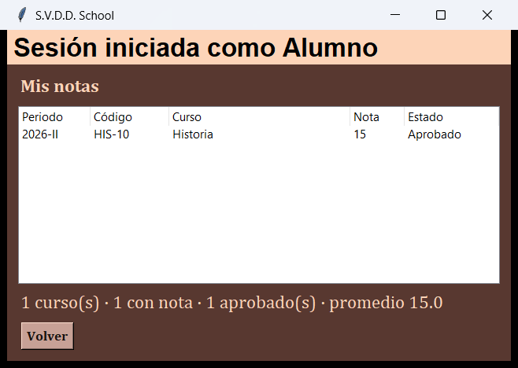

### MR-107 (EV03 R02) — Restaurar un respaldo desde la aplicación

- **Descripción:** desde la MR-104 el director podía crear respaldos, pero no volver a uno: había que cerrar la app y reemplazar `testdata.db` a mano. Ahora:
  - **Pantalla:** botón *Restaurar* en el panel del director. Elige el archivo (abre en `respaldos/`), confirma, y la app pide volver a iniciar sesión.
  - **BD:** antes de reemplazar se respalda la base actual (la restauración se puede deshacer) y, después, se ejecutan las migraciones.
  - **Permisos:** solo el director.
- **Tipo:** Perfectivo — completa la función de respaldo con la operación inversa.
- **Observaciones:**
  - **Migración de datos de versiones anteriores:** un respaldo hecho antes de la v6.0 no tiene la columna `nota` y guarda contraseñas en texto plano; uno de la v1.0 ni siquiera tiene `Curso` ni `Matricula`. Al restaurarlo se ejecutan las mismas migraciones idempotentes del arranque y queda con el esquema actual. Se probó restaurando la base original del proyecto. Es la idea de *Butterfly* del material: el respaldo (datos heredados) se abre **solo para lectura** y se transforma al esquema nuevo en una copia, sin tocar el original.
  - **Defecto encontrado al diseñar el orden de los pasos:** el respaldo de seguridad conserva solo las 10 copias más recientes, así que si el director elige el respaldo **más antiguo**, el de seguridad lo borra antes de leerlo. Se reprodujo con un script: el archivo elegido desaparecía. Por eso el respaldo se revisa y se copia a memoria **antes** de respaldar la base actual.
  - Se rechazan, sin cambiar nada: un archivo que no es SQLite, una base de otro programa (faltan `StudentData`, `TeacherData` o `PrincipalData`), un respaldo sin director (nadie podría administrar el sistema), la propia base en uso y un respaldo dañado (`PRAGMA integrity_check`).
  - En modo WAL, si otro programa (por ejemplo un visor de SQLite) tiene la base abierta, queda un `testdata.db-wal` que SQLite aplicaría sobre la base restaurada y la dañaría. Si existe tras cerrar la conexión, se cancela con «Base de datos ocupada».
  - El reemplazo es `os.replace` de una copia temporal: o queda la base anterior o la restaurada, nunca un archivo a medias.
  - Como los usuarios y contraseñas pueden ser otros, la sesión se cierra y se vuelve al login.
  - El recorrido automático no podía confirmar el «¿Continuar?»: el conductor cierra los diálogos con `WM_CLOSE` y un `askyesno` no tiene botón Cancelar, así que lo ignora. Se agregó `responder_si` (envía `IDYES`).
  - La ruta del respaldo se abre como URI (`Path.as_uri()`): con espacios o tildes («Mis respaldos ñandú») una URI escrita a mano fallaría.
- **Evidencia:** 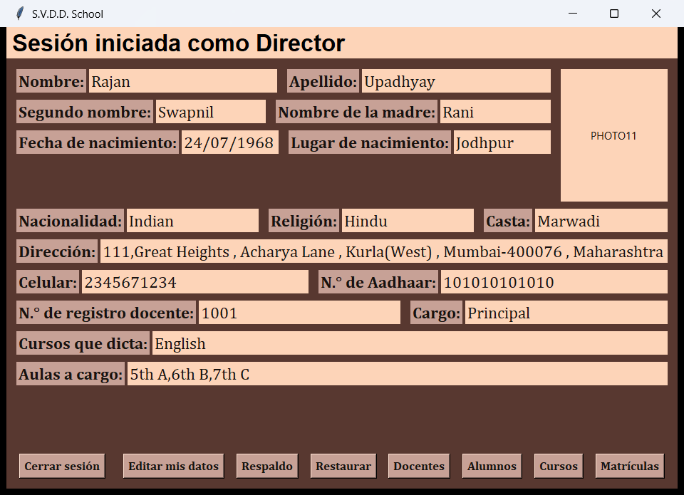 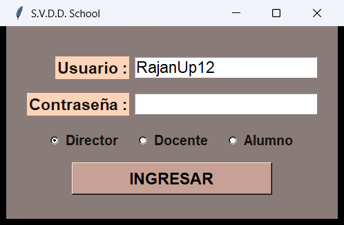

### Pruebas v6.0

113 pruebas (21 nuevas en `tests/test_v6.py`). 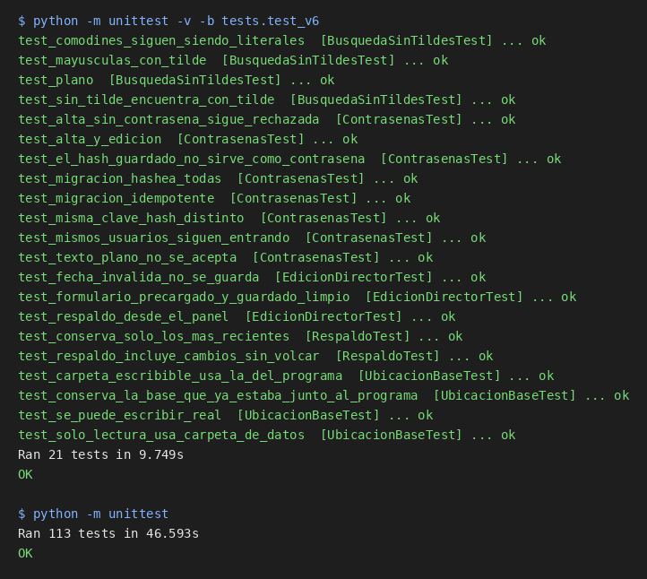

Con la EV03: 139 pruebas (13 nuevas en `tests/test_notas.py` y 13 en `tests/test_restaurar.py`). `herramientas/verificar_app.py` recorre también la nota (docente → alumno) y la restauración.
